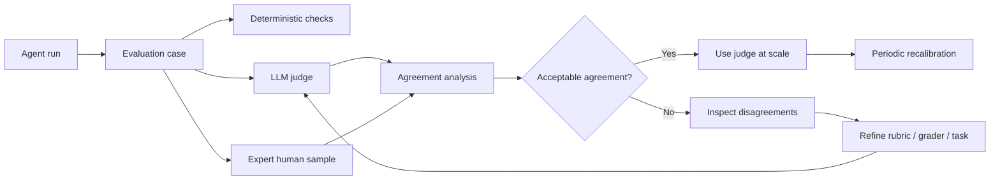

# Grader Calibration and Disagreement Analysis

## Why this matters

Once an agent evaluation suite grows beyond exact assertions, you will eventually use an LLM as a judge: another model reads an agent's output or trajectory and scores it against a rubric. This is useful for qualities such as correctness, completeness, grounding, code quality, or whether a migration preserved intent.

The danger is subtle: **a judge can be consistent and still be wrong**. If the judge systematically rewards verbose answers, misses an architectural constraint, or interprets a rubric differently from your subject-matter experts, your dashboard becomes precise-looking noise.

The practical solution is **grader calibration**: regularly compare automated grades with trusted human grades, study where they disagree, and improve the rubric or grading strategy before trusting the metric as a release gate.

Anthropic recommends deterministic graders where possible, model graders where necessary, and close calibration of LLM judges with human experts. It also recommends reading transcripts because disagreements often reveal ambiguous tasks or broken graders.

## Simple mental model

Think of an LLM judge as a **new engineer joining an architecture review board**.

You do not immediately allow the engineer to approve production changes. You first give them examples already reviewed by senior architects, compare their decisions, discuss disagreements, and clarify the review checklist.

The mapping is:

- **Human gold label** — the trusted decision from a domain expert.
- **Model grade** — the LLM judge's decision.
- **Calibration set** — a small, representative set that both humans and the judge grade.
- **Agreement** — how often they reach the same decision.
- **Disagreement analysis** — investigating *why* their decisions differ.
- **Rubric** — explicit criteria defining what good means.

Calibration is therefore not prompt tuning. It is **measurement-system validation**.

## Core components and request flow



A useful evaluation pipeline has three layers.

**1. Deterministic checks** answer questions where software can establish truth: Did tests pass? Was the required file produced? Did the agent call an unauthorized tool? Did the generated API specification parse?

**2. Model-based graders** handle semantic questions: Does the generated Spring Boot integration preserve the intent of the Mule flow? Is the explanation sufficiently grounded in retrieved evidence?

**3. Human reviewers** establish or periodically refresh the reference judgment for cases where semantics matter.

Do not ask an LLM to judge something a unit test can establish more reliably.

## Concrete example: migration agent

Suppose an agent migrates a MuleSoft integration to Spring Boot.

A deterministic grader can verify:

- generated project compiles;
- contract tests pass;
- required endpoints exist;
- no prohibited dependency was introduced.

But suppose you also need to answer:

> "Does the generated implementation preserve the important integration semantics of the source flow?"

That is harder to encode as a Boolean assertion. An LLM judge can compare the normalized source semantics, migration plan, and generated implementation using a rubric such as:

1. routing semantics preserved;
2. transformation intent preserved;
3. error handling preserved;
4. transaction behavior preserved;
5. no unsupported behavior invented.

Have architects independently grade a representative calibration set first. The model grader then evaluates the same cases without seeing the human labels.

## Measuring agreement in Python

For an initial binary PASS/FAIL grader, start simply:

```python
from dataclasses import dataclass

@dataclass
class Grade:
    case_id: str
    human: str
    judge: str

grades = [
    Grade("migrate-001", "PASS", "PASS"),
    Grade("migrate-002", "FAIL", "PASS"),
    Grade("migrate-003", "FAIL", "FAIL"),
    Grade("migrate-004", "PASS", "PASS"),
]

agreement = sum(g.human == g.judge for g in grades) / len(grades)

disagreements = [
    g for g in grades
    if g.human != g.judge
]

print(f"agreement={agreement:.1%}")

for g in disagreements:
    print(g.case_id, g.human, g.judge)
```

Agreement rate is useful but incomplete. If 95% of your examples pass, a judge that always says PASS gets 95% agreement.

For a binary grader, also track:

- **precision** — when the judge says PASS, how often is the human label PASS?
- **recall** — of the cases humans consider PASS, how many does the judge recognize?
- **confusion matrix** — PASS/FAIL combinations.
- **Cohen's kappa** — agreement adjusted for agreement that can occur by chance.

For ordinal scores such as 1–5, inspect score differences and use an agreement measure suitable for ordered ratings rather than reducing everything to exact matches.

## Disagreement analysis is more important than one score

Create a disagreement queue and classify each mismatch.

Typical categories are:

| Category | Meaning | Likely action |
|---|---|---|
| Judge error | Human rubric interpretation is clearly better | Improve grader prompt/model |
| Human error | Expert missed evidence | Correct gold label |
| Rubric ambiguity | Both interpretations are defensible | Rewrite rubric |
| Missing evidence | Judge lacks required context | Fix evaluator input |
| Task ambiguity | Expected behavior itself is unclear | Rewrite eval case |
| Borderline case | Reasonable experts may disagree | Human review or uncertainty band |

This taxonomy turns disagreement into engineering information.

If many disagreements are "missing evidence", changing the judge model is unlikely to help. If experts disagree with each other, the problem may be the product specification rather than the grader.

## Use dimension-specific graders

Avoid one prompt that asks:

> "Score this agent response from 1 to 10."

Instead, grade narrow dimensions separately:

```python
rubrics = {
    "semantic_preservation": """
    PASS only if routing, transformations, error handling,
    and transaction semantics required by the source are preserved.
    Return UNKNOWN when evidence is insufficient.
    """,
    "unsupported_changes": """
    FAIL if the implementation introduces business behavior
    that is absent from the source semantics or approved plan.
    Return UNKNOWN when evidence is insufficient.
    """,
}
```

This gives you explainable failures and lets you calibrate each dimension independently.

An explicit **UNKNOWN** outcome is valuable. Forcing a judge to choose PASS or FAIL when evidence is insufficient creates fabricated certainty.

## When each grader should win

Use a hierarchy rather than treating all graders as interchangeable.

**Deterministic evidence wins** when the requirement can be tested objectively. If a contract test proves that the response schema is wrong, an LLM's opinion should not override it.

**Human expert judgment wins** for ambiguous domain semantics and for calibrating model graders.

**LLM judges win on scale**, after calibration, for semantic dimensions where deterministic checks are insufficient and reviewing every run manually would be impractical.

A strong enterprise evaluator therefore looks like:

```text
objective invariant  -> deterministic grader
semantic quality     -> calibrated LLM grader
high-risk ambiguity  -> human review
```

## Common mistakes and failure modes

**Treating an LLM judge as ground truth.** It is another probabilistic model and needs evaluation itself.

**Using vague rubrics.** "Good architecture" or "high-quality migration" gives the judge too much interpretation freedom.

**Calibrating only once.** Changing the judge model, rubric, context format, or task distribution can change grading behavior.

**Only measuring aggregate agreement.** Inspect disagreement slices by task type and risk. A 92% overall agreement can hide 60% agreement on security-sensitive cases.

**Letting the judge see irrelevant metadata.** Model names, experiment labels, or which answer is the candidate can introduce bias.

**Using the same model configuration as both agent and judge without thought.** This is not automatically wrong, but correlated blind spots can reduce the independence of the evaluation signal.

**Ignoring human disagreement.** If two experts cannot reliably agree, demanding perfect agreement from the model is the wrong objective.

## Enterprise use cases

Calibration is particularly valuable for:

- code-generation quality assessment;
- application-modernization and migration agents;
- RAG groundedness and answer completeness;
- customer-service response quality;
- policy-compliance checks;
- document extraction and summarization;
- tool-selection quality;
- architecture-document review.

For high-risk workflows, use the LLM grader primarily for triage and routing until sufficient calibration evidence exists.

## Practical implementation guidance

Start with perhaps 50–100 representative cases rather than thousands. Include clear passes, clear failures, difficult boundary cases, and cases from important risk segments.

Store more than the final label:

```json
{
  "case_id": "migrate-042",
  "rubric_version": "semantic-preservation-v3",
  "human_label": "FAIL",
  "judge_label": "PASS",
  "human_reason": "Transaction boundary was lost",
  "judge_reason": "Routing and transformation were preserved",
  "task_class": "transactional-flow",
  "risk": "high"
}
```

Version the **rubric, judge model, judge prompt, evaluation inputs, and calibration dataset**. Otherwise a change in agreement cannot be explained later.

Run calibration:

- before adopting a new judge;
- after material rubric changes;
- after changing judge models;
- when production/task distribution shifts;
- periodically on sampled evaluations.

For Java, the same design maps cleanly to JUnit-based deterministic graders plus a typed judge result such as a Java record. In Go, keep grader outputs as small structs and calculate agreement metrics in the evaluation pipeline. The important architecture is language-independent.

## Cloud mappings

Cloud services can help operationalize the pipeline, but the calibration method should remain portable.

- **AWS:** use your model runtime plus normal CI/data tooling; keep human labels and grader results in a versioned evaluation dataset.
- **Azure:** use Azure AI evaluation capabilities where appropriate, while retaining domain-specific human calibration for custom graders.
- **GCP:** Vertex AI provides model-based evaluation and documented mechanisms for evaluating an autorater against human ratings.

The managed service is not a substitute for defining your organization's ground truth.

## 30–60 minute exercise

Take **20 outputs** from an existing coding or migration task.

1. Define one binary rubric: for example, "semantic intent preserved."
2. Grade all 20 yourself without using an LLM judge.
3. Ask an LLM judge to grade the same 20 using your rubric.
4. Calculate raw agreement.
5. List every disagreement.
6. Classify each as judge error, human error, rubric ambiguity, missing evidence, task ambiguity, or borderline.
7. Rewrite the rubric based on what you discovered.
8. Re-run the judge, but keep the original human labels unchanged.

The objective is not to maximize the score. It is to understand **why the measurement disagrees with the judgment you actually care about**.

## What to learn next

Next: **evaluation confidence and repeated trials** — why one agent run per test case can be misleading, how stochasticity affects pass rates, and when to use pass@k-style measurements or repeated trials before deciding that a release is better.

## Reading

1. [Anthropic — Demystifying evals for AI agents](https://www.anthropic.com/engineering/demystifying-evals-for-ai-agents)
2. [Google Cloud — Evaluate a judge model](https://docs.cloud.google.com/gemini-enterprise-agent-platform/models/evaluate-judge-model)
3. [Google Cloud — Continuous evaluation for reliable AI agents](https://cloud.google.com/blog/topics/developers-practitioners/from-vibe-checks-to-continuous-evaluation-engineering-reliable-ai-agents)
4. [Google Cloud — Agent evaluation in Vertex AI](https://cloud.google.com/blog/products/ai-machine-learning/introducing-agent-evaluation-in-vertex-ai-gen-ai-evaluation-service)
