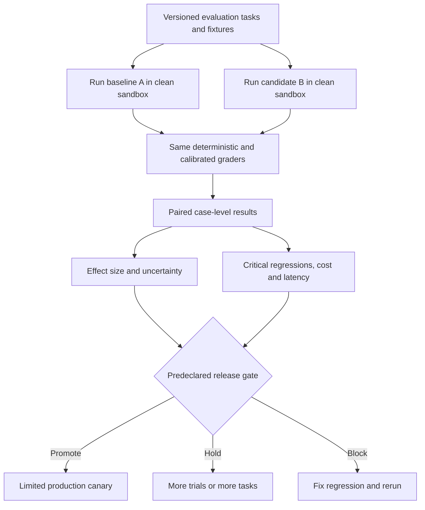

# Paired Agent Experiments: When Is a Candidate Release Actually Better?

> **Daily AI Engineering Learning \| 9 October 2026 \| Evaluation \| Estimated reading time: 9 minutes**
**The central lesson:** Test the baseline and candidate on the *same tasks*, compare the differences task by task, and require evidence plus safety checks before promotion. A higher overall pass rate alone does not prove a better agent.
## Why this matters
Yesterday we learned why repeated trials are needed to understand agent variability. Today we answer the next practical question: after changing a prompt, model, retrieval strategy, or tool implementation, **how do we decide whether the new version deserves deployment?**
Imagine a MuleSoft-to-Spring Boot migration assistant. Release A passes 70% of one test set; release B passes 80% of another. That comparison is not useful if B received easier flows. Even if both ran the same tests, an observed improvement can be due to sampling noise, and a candidate can improve overall while breaking a critical transactional workflow.
A **paired experiment** makes each test case its own control. A **release gate** is a predeclared rule that determines whether the candidate is promoted, held for more evidence, or blocked.
## Simple mental model: a controlled architecture review
Think of two migration implementations submitted for review. Give both the *same source flows*, the *same reference contracts*, and the *same acceptance tests*. Compare their outcomes **flow by flow**, not by separate average scores. Then ask whether the improvement is sufficiently convincing and whether any non-negotiable architectural constraint was violated.
Definitions:
- **Baseline:** the current approved agent release (A).
- **Candidate:** the proposed release (B), such as a new prompt or model.
- **Paired case:** the same task, input data, and grading rubric evaluated against both releases.
- **Effect size:** the practical magnitude of the difference, e.g. a 10-percentage-point improvement in task success.
- **Discordant pair:** a case where A and B disagree: B fixes an A failure, or B breaks an A success.
- **Statistical evidence:** how compatible the observed differences are with a no-improvement hypothesis under a stated test.
- **Hard gate:** a rule that cannot be offset by a higher average score, such as no new unauthorized tool use.
**Important:** A small p-value is not a probability that B is correct or that B will work in production. It is one piece of evidence under assumptions; a large p-value is not proof of equality.
## Core components and request flow

The practical pipeline is:
1. **Freeze the comparison contract.** Version task IDs, source artifacts, acceptance criteria, grader version, fixtures, and agent release manifests. Predeclare the minimum improvement and the maximum tolerated regression.
2. **Run both releases on the same cases.** Use clean sandboxes; isolate generated files, databases, memory, and tool side effects. Alternate execution order when practical to reduce time-related bias.
3. **Grade outcomes, not persuasive text.** For migration, compile the project, run contract tests, compare message transformations and error semantics, and check prohibited behaviors.
4. **Compare paired results.** Count cases fixed by B and cases broken by B. Estimate the change in task-success rate and uncertainty.
5. **Apply gates in order.** Block critical regressions; require meaningful improvement with sufficient evidence; check latency and cost; only then consider a controlled canary.
## Concrete implementation: migration-agent release A versus B
Suppose release B changes how the migration agent plans error handling. Both versions process twelve frozen Mule integration tasks. The outcomes below are **illustrative, not production measurements**.
```python
# pip install scipy
from scipy.stats import binomtest

# (case_id, baseline_pass, candidate_pass, business_risk)
cases = [
    ("http-routing",    1, 1, "medium"),
    ("transform",       1, 1, "medium"),
    ("error-handler",   0, 1, "high"),
    ("retry-policy",    0, 1, "medium"),
    ("oauth",           1, 1, "high"),
    ("timeout",         0, 1, "medium"),
    ("message-mapping", 1, 0, "high"),
    ("database",        1, 1, "high"),
    ("dead-letter",     0, 1, "high"),
    ("headers",         1, 1, "medium"),
    ("transaction",     0, 0, "high"),
    ("schema",          1, 1, "medium"),
]

n = len(cases)
a_rate = sum(a for _, a, _, _ in cases) / n
b_rate = sum(b for _, _, b, _ in cases) / n
gains = sum(a == 0 and b == 1 for _, a, b, _ in cases)
losses = sum(a == 1 and b == 0 for _, a, b, _ in cases)
discordant = gains + losses

# Exact one-sided McNemar-style test:
# under equal success probabilities, gains/losses among
# discordant, independent task pairs are equally likely.
p_value = (
    binomtest(gains, discordant, p=0.5,
              alternative="greater").pvalue
    if discordant else 1.0
)
critical_regressions = [
    task for task, a, b, risk in cases
    if a == 1 and b == 0 and risk == "high"
]

# Illustrative policy; set thresholds before running an eval.
min_gain = 0.05
if critical_regressions:
    decision = "BLOCK"
elif b_rate - a_rate >= min_gain and p_value < 0.05:
    decision = "PROMOTE_TO_CANARY"
else:
    decision = "HOLD_FOR_MORE_EVIDENCE"

print(f"A={a_rate:.1%}, B={b_rate:.1%}, "
      f"delta={b_rate-a_rate:+.1%}")
print(f"gains={gains}, losses={losses}, p={p_value:.4f}")
print(f"critical regressions={critical_regressions}")
print(f"decision={decision}")
```
**Expected interpretation:** A passes 7/12 (58.3%), B passes 10/12 (83.3%), so B appears **25 percentage points better**. But only five tasks disagree: four gains and one loss. The one-sided exact p-value is **0.1875**, not below the illustrative 0.05 threshold. More importantly, B breaks the high-risk message-mapping case. The decision is **BLOCK**, not automatic promotion.
This is a useful architectural outcome: aggregate quality improved, but the candidate still fails a release contract.
### Why pairing matters
If A and B run on different test sets, a harder dataset can masquerade as a worse release. In a paired design, each task contributes a direct comparison. For binary outcomes, only discordant pairs provide evidence about which release wins. A McNemar-style test uses that fact.
**Scope and assumptions:** The simple test above uses one binary outcome per independent task. It is a small demonstration, not an enterprise-grade sample-size justification. For three or more trials per task, **do not count every trial as an independent task**. Estimate each task's success-rate difference and use a *task-cluster bootstrap* or another repeated-measures method to preserve within-task dependence. The experimental unit for generalization is normally the task, not each retry.
## Implementation guidance
Start with an offline eval runner that emits a stable record:
```json
{
  "case_id": "message-mapping",
  "baseline_release": "migration-agent-1.8.0",
  "candidate_release": "migration-agent-1.9.0",
  "fixture_version": "mule-suite-2026-10",
  "grader_version": "contract-grader-4",
  "baseline_pass": true,
  "candidate_pass": false,
  "risk": "high",
  "reason": "Null-handling behavior changed"
}
```
Keep the comparison code outside the agent harness. The agent executes; the grader decides success; the release evaluator compares versions. This separation makes the gate auditable and reduces accidental grader manipulation.
Use **Python + pytest** for deterministic contract checks and **SciPy** for a first paired binary test. In **Java**, JUnit plus an offline comparison job provides the same separation. In **Go**, use `testing` and a structured JSONL results file; the statistical decision can remain in a small Python CI step.
A practical gate should separately check: (a) critical correctness/security regressions, (b) minimum quality gain, (c) uncertainty or sufficient evidence, (d) P95 latency and cost budgets, and (e) segment-specific outcomes. For example, treat transactional migrations as a separate high-risk segment instead of letting many simple routing tasks hide regressions.
## Common mistakes and failure modes
- **Comparing different task sets:** case difficulty, not release quality, drives the result. Pair tasks and fixtures.
- **Tuning after looking at the holdout:** repeated candidate changes overfit the final evaluation. Keep a separate unseen set.
- **Treating retries as independent observations:** this inflates confidence. Group repeated trials by task.
- **Using a p-value as a business threshold:** statistical evidence does not say whether the gain is worth latency, cost, or risk. Set a minimum useful improvement.
- **Ignoring negative movement:** a 20-point aggregate gain can conceal a regression in an authorization or transaction case. Add non-negotiable gates.
- **Changing grader and agent simultaneously:** an apparent gain may be grader drift. Version the grader and regrade both releases consistently.
- **Peeking repeatedly and stopping when p \< 0.05:** unplanned repeated testing increases false positives. Predefine sample size and stopping rules, or use a valid sequential-testing design.
- **Confusing offline success with production readiness:** a successful offline gate leads to a limited canary, not an immediate 100% rollout.
## Enterprise use cases
**Integration migration:** compare MuleSoft-to-Spring Boot agents on identical flows, using compilation, contract tests, error-handling parity, and transaction semantics as gates.
**Agentic RAG:** compare two retrievers on the same questions and frozen knowledge snapshot. Measure answer correctness and citation grounding; reject any increase in unauthorized data exposure.
**Coding assistant:** compare two model/prompt combinations on the same repository tasks in fresh worktrees, with unit tests, security checks, and changed-file limits.
**Customer-service agent:** compare refund/claims workflows on identical simulated cases, with hard gates for policy violations and unauthorized writes.
## Cloud service mapping — only where useful
No special cloud product is required for the statistical method. Run the same Python evaluator in an existing CI/CD system. On **AWS**, store versioned fixtures in S3 and run isolated jobs via CodeBuild or ECS; on **Azure**, use Blob Storage and Azure DevOps or Container Apps Jobs; on **GCP**, use Cloud Storage and Cloud Build or Cloud Run Jobs. Cloud services host the test infrastructure; they do not replace task design or statistical judgment.
## Hands-on exercise (45 minutes)
1. **10 min:** Select 12–20 migration or code-assistant tasks. Mark 3–5 as high risk, and write objective PASS criteria.
2. **15 min:** Run the Python example. Add two more B regressions, including one high-risk task, and observe the gate.
3. **10 min:** Change the minimum improvement to 10 percentage points. Decide in advance what evidence you would need before promotion.
4. **10 min:** Sketch a CI job that writes `case_id, release_id, grader_version, pass, latency_ms, cost_usd` and publishes a paired release report.
**Deliverable:** a short release policy with three possible decisions: `PROMOTE_TO_CANARY`, `HOLD_FOR_MORE_EVIDENCE`, and `BLOCK`. State which failures are never offset by an average improvement.
## What to learn next
**Task-cluster bootstrap and confidence intervals for repeated agent trials:** when each eval case runs several times, estimate uncertainty without falsely treating correlated retries as independent tasks.
## Further reading
1. [Anthropic — Demystifying evals for AI agents](https://www.anthropic.com/engineering/demystifying-evals-for-ai-agents) — task design, repeated trials, graders, and isolated environments.
2. [OpenAI — Evaluation best practices](https://developers.openai.com/api/docs/guides/evaluation-best-practices) — eval-driven iteration and representative datasets.
3. [SciPy — Exact binomial test](https://docs.scipy.org/doc/scipy/reference/generated/scipy.stats.binomtest.html) — the statistical primitive used in the example.
4. [statsmodels — McNemar test](https://www.statsmodels.org/stable/generated/statsmodels.stats.contingency_tables.mcnemar.html) — paired binary-outcome testing.
5. [Google SRE — Canarying releases](https://sre.google/workbook/canarying-releases/) — production rollout and separate control/canary measurements.
