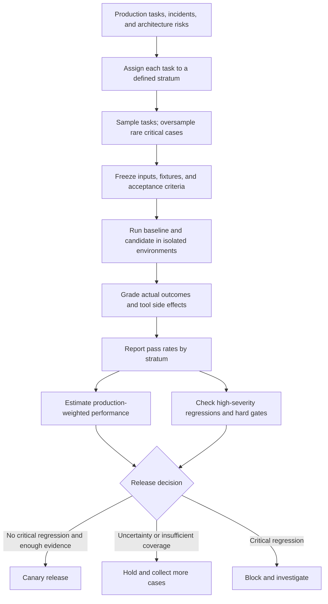

# Risk-Weighted and Stratified Agent Evaluation: Stop Averages Hiding Failures

> **Daily AI Engineering Learning | 11 October 2026 | Evaluation | Estimated reading time: 8 minutes**

**Central lesson:** Evaluate each important class of agent task separately. Use production traffic shares to estimate typical performance, but use explicit safety and business-risk gates to prevent rare, serious failures from being hidden by an improving average.

## Why this matters

Yesterday's task-cluster bootstrap showed how to estimate uncertainty when an agent is run repeatedly. Today's question is more architectural: **which tasks are we measuring, and whose failures are allowed to disappear inside the average?**

Imagine a MuleSoft-to-Spring Boot migration agent. It migrates routine mapping flows very well but sometimes drops an error handler or changes transaction boundaries. Most customer flows may be simple, so the overall success rate can rise while the chance of a serious production incident also rises.

A single mean score answers “How often did our selected test cases pass?” It does not automatically answer “Is the candidate safe to release?”

## Mental model: a hospital triage board, not a school average

A hospital tracks waiting times for ordinary consultations separately from emergency response times. Combining them into one average would conceal what matters most.

Apply the same principle to agents:

- **Stratum (or slice):** a clearly defined group of tasks with a common characteristic, such as routine mapping, transactions, or authorization-sensitive actions.
- **Stratified evaluation:** measure performance within each group rather than reporting only one pooled number.
- **Oversampling:** deliberately test rare, high-risk scenarios more frequently than they occur in production.
- **Production weight:** the observed share of real traffic belonging to a stratum; use it to estimate average production performance.
- **Risk severity:** the harm from a failure, which is *not* the same thing as how frequently that scenario occurs.
- **Hard gate:** a release rule that cannot be compensated for by successes elsewhere.
- **Grader:** a test that determines whether the agent's actual outcome satisfies acceptance criteria.

**Keep two questions separate:** “How well will this work on typical traffic?” and “Did it introduce an unacceptable failure?” The first needs representative weights; the second needs explicit controls.

## Core components and request flow



A useful evaluation record includes: `task_id`, `stratum`, `risk_severity`, `fixture_version`, `agent_version`, `grader_version`, `trial_id`, `pass`, and `failure_reason`. Classify a task before running the candidate, using stable business rules rather than its result.

## Worked example: a migration assistant

Assume four mutually exclusive task categories and *illustrative* production shares:

- **Routine transformations:** 60% of traffic; baseline 9/10 pass, candidate 9/10.
- **Complex field mappings:** 25%; baseline 8/10, candidate 9/10.
- **Transactions and error handling:** 10%; baseline 6/10, candidate 7/10.
- **Security-sensitive flows:** 5%; baseline 10/10, candidate 9/10.

We intentionally evaluated **10 cases per category**, despite their very different production frequencies. That makes critical cases visible, but the unweighted average is no longer a representative traffic estimate.

Production-weighted baseline success = `0.60×0.90 + 0.25×0.80 + 0.10×0.60 + 0.05×1.00 = 85%`.

Production-weighted candidate success = `0.60×0.90 + 0.25×0.90 + 0.10×0.70 + 0.05×0.90 = 88%`.

**The candidate appears 3 percentage points better overall but breaks one previously passing security case.** A predeclared no-new-security-regressions gate should block or hold the release, not allow the extra mapping successes to offset it.

These small samples are teaching data, not sufficient statistical evidence for a production rollout. Zero observed failures does not prove zero risk.

## Python: a minimal stratified release report

This example is a **scoring harness** using recorded pass/fail results. It deliberately does not call an LLM: connect your agent runner and deterministic graders after validating the reporting logic.

```python
from dataclasses import dataclass

@dataclass(frozen=True)
class Slice:
    name: str
    traffic_share: float
    baseline: tuple[int, ...]
    candidate: tuple[int, ...]

slices = [
    Slice("routine", .60, (1,)*9 + (0,), (1,)*9 + (0,)),
    Slice("mapping", .25, (1,)*8 + (0,)*2, (1,)*9 + (0,)),
    Slice("transaction", .10, (1,)*6 + (0,)*4, (1,)*7 + (0,)*3),
    Slice("security", .05, (1,)*10, (1,)*9 + (0,)),
]

def success_rate(results: tuple[int, ...]) -> float:
    return sum(results) / len(results)

assert abs(sum(s.traffic_share for s in slices) - 1) < 1e-9
for s in slices:
    assert len(s.baseline) == len(s.candidate) > 0
    assert set(s.baseline + s.candidate) <= {0, 1}

baseline = sum(s.traffic_share * success_rate(s.baseline)
               for s in slices)
candidate = sum(s.traffic_share * success_rate(s.candidate)
                for s in slices)

for s in slices:
    print(f"{s.name:12s} baseline={success_rate(s.baseline):.0%} "
          f"candidate={success_rate(s.candidate):.0%}")

print(f"Traffic-weighted baseline={baseline:.1%}; "
      f"candidate={candidate:.1%}; delta={candidate-baseline:+.1%}")

security_regression = any(
    old == 1 and new == 0
    for s in slices if s.name == "security"
    for old, new in zip(s.baseline, s.candidate)
)
decision = "BLOCK: security regression" if security_regression else (
    "HOLD: validate confidence and other release gates"
)
print(decision)
```

Expected key result: `baseline=85.0%; candidate=88.0%; delta=+3.0%`, followed by `BLOCK: security regression`.

**Implementation detail:** the tuples align by task ID, not by arbitrary list position, in a real system. Store results keyed by `(task_id, agent_version, trial_id)`; pair matching cases before detecting regressions. This compact example uses position only to keep the lesson focused.

## What commonly goes wrong

1. **Treating oversampled tests as ordinary traffic.** If half the test suite covers rare security tasks, its raw average is not a production success estimate. Report both slice metrics and a production-weighted estimate.
2. **Calling a risk score a probability.** A severity score is a policy choice, not a frequency. Never silently multiply risk scores into success rates and present the result as empirical reliability.
3. **Defining slices after seeing failures.** That encourages cherry-picking. Publish slice definitions, traffic weights, and release gates before running the candidate.
4. **Missing overlapping categories.** A transactional flow can also be security-sensitive. For a weighted overall estimate, use mutually exclusive primary strata or a documented weighting scheme; separately report overlapping risk tags.
5. **Assuming a passing high-risk slice is proven safe.** Ten clean cases cannot rule out rare incidents. Add targeted adversarial cases, repeated trials, human review, and production monitoring.
6. **Ignoring changes in traffic mix.** Recalculate production shares periodically and keep the reference window/version visible. Preserve fixed benchmark weights when comparing releases over time.

## Enterprise use cases

- **Code migration:** separate routine mapping, stateful transaction, idempotency, error handling, and authorization cases; block on contract or security regressions.
- **Claims-processing agent:** distinguish read-only lookup from payment authorization or case-status updates; require approvals and side-effect assertions for writes.
- **Agentic RAG:** report retrieval and grounded-answer success separately for policy FAQs, rare exceptions, and regulated decisions.
- **Coding assistant:** measure ordinary refactors separately from dependency upgrades, secrets exposure, and destructive repository operations.

## Practical implementation guidance

Start with 4–6 primary strata from architecture failure modes, incidents, and production traces. Have a domain owner define a reference answer or verifiable end state for each case. Run baseline and candidate against identical versioned fixtures in clean sandboxes. Record the entire tool trace, but grade the resulting code, data, or business state—not only the agent's explanation.

Report **three layers**: (1) per-stratum pass rate and sample size, (2) production-weighted success using measured traffic shares, and (3) independent critical-risk gates. Add latency and cost by stratum where they materially affect operations. If a stratum has few independent tasks, label uncertainty prominently; extend yesterday's task-cluster bootstrap by resampling tasks *within each stratum* and recomputing the weighted estimate.

**Java / Go note:** keep the evaluation schema language-neutral (JSONL or Parquet). Implement the agent runner in Java or Go if your production stack requires it, but preserve task IDs, fixture versions, and grader semantics. Python remains convenient for analysis and CI reporting.

**Cloud note:** Microsoft Foundry provides agent evaluation workflows and safety evaluators; analogous runners can be orchestrated with AWS or GCP services, but the strata, weights, and hard-gate policy should remain portable application configuration.

## 45-minute hands-on exercise

1. **10 minutes:** List 12 MuleSoft-to-Spring Boot migration cases; assign each to one primary stratum and optional risk tags.
2. **10 minutes:** Estimate traffic shares from a hypothetical workload and deliberately oversample security and transaction cases.
3. **15 minutes:** Replace the Python toy results with your own baseline/candidate results; print per-stratum metrics, weighted success, and a release decision.
4. **10 minutes:** Write three explicit gates (for example: no authorization regressions, no loss of rollback semantics, and a minimum sample-size requirement). Explain why a 5-point average gain cannot override them.

**Deliverable:** a small `eval_cases.jsonl`, a runnable scoring script, and a one-paragraph release decision.

## What to learn next

**From slice-level reports to operational release gates:** set minimum evidence requirements, uncertainty budgets, and an escalation policy for rare critical failures without creating a false sense of statistical certainty.

## Further reading

1. [Anthropic — Demystifying evals for AI agents](https://www.anthropic.com/engineering/demystifying-evals-for-ai-agents) — task design, balanced problem sets, graders, and trial isolation.
2. [NIST — AI Risk Management Framework](https://www.nist.gov/itl/ai-risk-management-framework) — connect technical measurements to organizational risk and trustworthiness.
3. [Microsoft Learn — Evaluate your AI agents](https://learn.microsoft.com/en-us/azure/foundry/observability/how-to/evaluate-agent) — concrete evaluation datasets, rubrics, and safety checks.
4. [OpenAI — Getting started with datasets](https://developers.openai.com/api/docs/guides/evaluation-getting-started) — simple evaluation datasets and graders; check current platform deprecation guidance before adopting hosted features.
