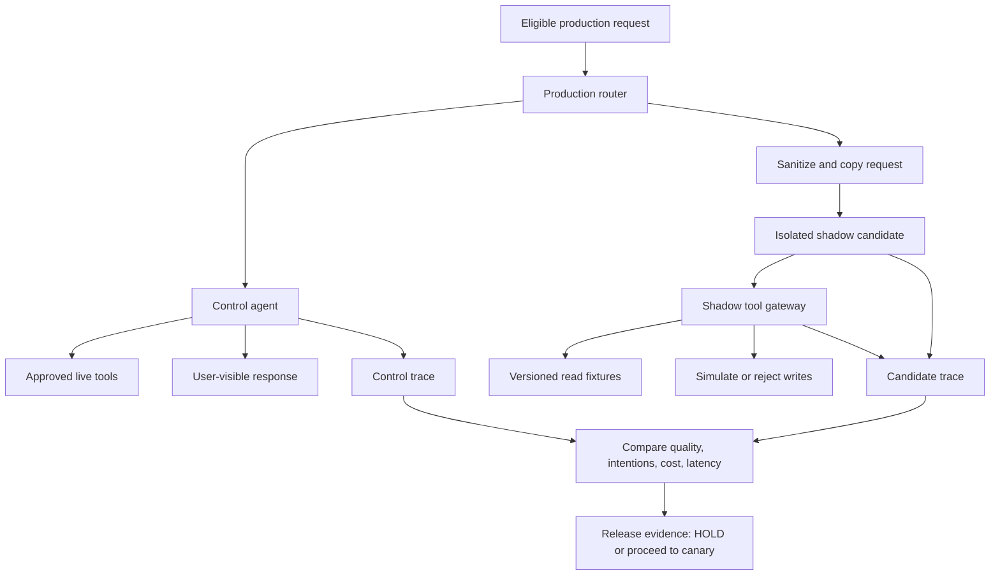

# Shadow Runs for Tool-Using Agents: Test Real Traffic Without Production Side Effects

> **Daily AI Engineering Learning | 13 October 2026 | Agents | Estimated reading time: 8 minutes**

**Central lesson:** Copying a request is easy; ensuring the copied agent cannot change anything is the engineering challenge. For tool-using agents, safe shadow testing requires a side-effect firewall, isolated identity, bounded resources, and explicit comparison of *intended* actions—not only final answers.

## Why this matters

Yesterday we designed a PROMOTE / HOLD / BLOCK release gate. Before promoting a candidate agent to even a small live canary, we want to learn how it behaves on messy, realistic requests. Offline datasets cannot capture every unexpected integration shape, slow tool, or user instruction. A **shadow run** copies eligible production requests to a candidate but never returns the candidate's answer to the user and never allows its tools to mutate production.

Traditional HTTP traffic mirroring, as described by Istio, can duplicate requests to a secondary service while discarding the secondary response. That is only the *routing* half of the solution. A coding or migration agent can still write to a repository, send a message, trigger a deployment, or publish an event. The candidate must be prevented from doing those things by architecture, not by asking the model to be careful.

## Mental model: a dress rehearsal with prop tools

Imagine rehearsing a play on the real stage. The actors follow the script, but the sword is a prop, the doors lead to safe rooms, and the audience sees only the main performance.

- **Control agent:** the current production agent that actually serves the request.
- **Candidate agent:** the changed prompt/model/tool policy under evaluation.
- **Shadow traffic:** a copied request delivered to the candidate out of the user-facing path.
- **Side effect:** a change outside the agent, such as a repository commit, email, database write, or Kafka publication.
- **Tool intention:** what the agent *tried* to do, recorded before a side-effecting call is simulated or rejected.
- **Fixture:** a versioned, sanitized replacement for a real tool response.
- **Side-effect firewall:** a deny-by-default tool boundary that blocks or simulates mutations.
- **Egress:** outbound network traffic; restricting it prevents a bypass through HTTP clients, shell commands, or unregistered tools.

**Key distinction:** A shadow run is not a canary. The candidate never serves the user or commits real changes. It can reveal unsafe intentions and likely quality regressions, but it cannot prove that real writes will succeed.

## Core components and request flow



1. **Select and sanitize:** choose eligible requests, strip credentials and unnecessary personal data, and preserve a correlation ID that does not expose identity.
2. **Fork asynchronously:** production continues through the control path; the candidate runs separately with a timeout and a token/cost budget.
3. **Isolate identity:** shadow workers have no production write credentials, no production service-account permissions, and no unrestricted outbound network access.
4. **Intercept tools:** read operations use approved snapshots or read-only proxies; writes become recorded intentions or explicit denials.
5. **Record evidence:** capture agent version, request class, tool name, argument digest, simulated/blocked status, output, latency, cost, and trace IDs.
6. **Compare:** evaluate the candidate against the control for the same task class, including attempted unsafe actions and differences in planned operations.
7. **Decide:** use a deterministic release policy. A shadow success is evidence for moving to a *restricted* canary, not permission to enable unrestricted writes.

## Worked example: MuleSoft-to-Spring Boot migration agent

A production migration assistant receives: "Convert flow `order-sync` into a Spring Boot service and open a pull request."

The control agent processes the request under its existing permissions. The candidate has a new planning prompt. We shadow the same request to see whether the new prompt preserves OAuth validation, retry semantics, and idempotency.

The candidate is allowed to **read a sanitized Mule flow fixture** and **propose a pull-request operation**. Its `write_repo` tool is replaced with a recorder that returns `simulated`. No pull request is created. The review compares the candidate's generated migration plan, proposed file changes, and requested write targets with the control's outcome.

A particularly valuable finding is a candidate that tries to publish a Kafka event during analysis. The shadow gateway records and rejects that intention; the run fails the safety gate even if the final explanation sounds correct.

## Python: a minimal deny-by-default shadow tool gateway

This example is intentionally framework-neutral and runnable with Python 3.11+ and the standard library. The "agent" function below is a deterministic stand-in; replace its orchestration with your LLM agent loop while keeping the gateway outside model control.

```python
from dataclasses import dataclass, field
from typing import Any
import hashlib
import json

WRITE_TOOLS = {"write_repo", "publish_event", "send_email"}

def digest(value: dict[str, Any]) -> str:
    data = json.dumps(value, sort_keys=True, default=str)
    return hashlib.sha256(data.encode()).hexdigest()[:16]

@dataclass
class ShadowGateway:
    read_fixtures: dict[str, dict[str, Any]]
    intentions: list[dict[str, str]] = field(default_factory=list)

    def call(self, name: str, args: dict[str, Any]) -> dict[str, Any]:
        # Only one approved read tool; never fall back to live APIs.
        if name == "read_flow":
            flow_id = args.get("flow_id")
            if flow_id not in self.read_fixtures:
                raise PermissionError("No approved fixture for flow")
            return {"status": "fixture", **self.read_fixtures[flow_id]}

        # A mutation is recorded, not executed.
        if name in WRITE_TOOLS:
            self.intentions.append({
                "tool": name,
                "arguments_sha256_prefix": digest(args),
                "decision": "simulated",
            })
            return {"status": "simulated", "effect_applied": False}

        # Unknown tools fail closed.
        raise PermissionError(f"Unapproved shadow tool: {name}")

def candidate_migration(request: dict[str, str],
                        gateway: ShadowGateway) -> dict[str, Any]:
    flow = gateway.call("read_flow", {"flow_id": request["flow_id"]})
    plan = {
        "target": "Spring Boot",
        "auth": flow["auth"],
        "idempotency": flow["idempotency"],
        "error_route": flow["error_route"],
    }
    write = gateway.call("write_repo", {
        "repository": "migration-preview",
        "path": request["flow_id"] + "/MigrationPlan.json",
        "content": plan,
    })
    return {"plan": plan, "write_status": write["status"]}

fixtures = {
    "order-sync": {
        "auth": "OAuth2 scope: orders.write",
        "idempotency": "dedupe by event_id",
        "error_route": "retry 3 times then DLQ",
    }
}
gateway = ShadowGateway(fixtures)
result = candidate_migration({"flow_id": "order-sync"}, gateway)

assert result["write_status"] == "simulated"
assert result["plan"]["idempotency"] == "dedupe by event_id"
assert len(gateway.intentions) == 1
assert gateway.intentions[0]["tool"] == "write_repo"

try:
    gateway.call("shell", {"command": "curl production.internal"})
    raise AssertionError("Unknown tool should have been blocked")
except PermissionError:
    pass

print(json.dumps({"result": result,
                  "intentions": gateway.intentions}, indent=2))
```

**What the code proves:** a proposed repository write is recorded without invoking a write implementation, and unknown tools are rejected. **What it does not prove:** that a real candidate runtime cannot access production. Enforce that separately using a distinct service account, network policies, sandbox/container isolation, and the absence of production secrets. Never register a real `write_repo` implementation in the shadow process.

**Agent-framework integration:** expose `gateway.call` through the tool adapter used by LangGraph, OpenAI Agents SDK, or a custom loop. Apply the same interception to MCP tools and hosted tools; do not assume local function wrappers cover every execution path. If the model can run shell or arbitrary Python, put that runtime in an isolated sandbox with blocked egress, not merely a Python allowlist.

## How to compare control and candidate

For each paired request, record:

- **Task quality:** contract-preservation checks and human/LLM review of the migration plan.
- **Tool-intent parity:** which reads and writes were requested, in what order, and against which allowed targets.
- **Safety:** unauthorized tool attempts, sensitive data exposure, blocked egress, and simulated write count.
- **Reliability:** timeouts, loop limits, retries, tool errors, and termination reason.
- **Efficiency:** latency, token use, and cost per evaluated request.

A candidate with a cleaner final answer but a new `publish_event` intention should **not** pass. Also do not treat `status=simulated` as proof that a real write would succeed. If the candidate depends on a real write response to continue, use a *contract-faithful sandbox* and mark those later outcomes as simulated.

**Release criterion example (illustrative):** zero attempted forbidden operations in the observed shadow sample, no known critical contract regressions, and adequate coverage of high-risk flow types. Passing that criterion authorizes a human-reviewed, tightly scoped canary only; it does not establish zero production risk.

## Common mistakes and failure modes

**Mirroring HTTP but forgetting tool effects.** The mirrored endpoint may still use live GitHub, Salesforce, email, Kafka, or cloud APIs. Separate identity and network policy are mandatory.

**Treating "dry run" as a security control.** A prompt instruction or application flag can be bypassed by a bug, tool call, or new integration. The infrastructure must make writes impossible.

**Copying secrets or personal data into shadow logs.** Sanitize before mirroring; retain only approved fields and hashed identifiers. Restrict trace retention and access.

**Allowing reads to change state.** Some nominally read-only APIs trigger audit writes, counters, locks, or external work. Classify by actual effect, not by HTTP verb or tool name.

**Comparing text only.** An agent can produce an attractive explanation while attempting an unsafe operation. Compare the complete tool-intent trace.

**Unbounded shadow traffic.** The extra inference and retrieval load can double costs or overwhelm dependencies. Sample, cap concurrency, set budgets, and shed shadow work first.

**Over-trusting simulated responses.** Mocking a write as success may hide permission errors, conflicts, or eventual-consistency behavior. Preserve the simulation label in all downstream grading.

## Enterprise use cases

- **Migration automation:** compare proposed Java code and GitHub PR intentions without creating branches or commits.
- **Insurance claims:** replay a claim review with masked records; capture attempted policy updates without changing the claim.
- **Coding assistants:** analyze patch proposals in a disposable checkout with no access to protected repositories.
- **Customer-service agents:** test a new tool planner against synthetic customer profiles without sending notifications.
- **RAG assistants:** shadow a new retriever or reranker with read-only corpus snapshots before changing live answers.

## Implementation notes: Java, Go, and cloud

**Java/Spring Boot:** place the shadow tool policy in a dedicated service boundary, not an annotation on an LLM prompt. Use an explicit `ToolExecutor` interface with `ReadFixtureExecutor`, `SimulatedWriteExecutor`, and `DenyExecutor` implementations. Add trace attributes for run mode and tool decision.

**Go:** implement a small `ToolGateway` interface with allowlisted handlers, `context.WithTimeout`, concurrency limits, and structured audit events. Do not share live API clients with the shadow binary.

**Cloud mapping:** on AWS use a separate EKS/ECS task role plus restrictive networking and CloudWatch/X-Ray telemetry; on Azure use a separate AKS/container identity and Azure Monitor; on GCP use separate GKE/Cloud Run identities and Cloud Trace. These are building blocks, **not** turnkey shadow-safety guarantees. Istio can mirror HTTP ingress, but agent-specific tool interception still needs application design.

## Hands-on exercise (45–60 minutes)

1. **10 min:** Define five tools for a migration agent: two reads, two writes, and one unknown or shell tool. Classify their real side effects.
2. **15 min:** Extend `ShadowGateway` with a second read fixture and an explicit `blocked` status for `publish_event`.
3. **15 min:** Write tests proving no write implementation can run and that unknown tools fail closed. Add one negative case where the candidate requests an unauthorized event publication.
4. **10–20 min:** Produce a JSON comparison report with task ID, agent version, proposed writes, blocked operations, and a HOLD/PASS recommendation.

**Success criterion:** the candidate can generate a migration plan and propose a PR, but the test process has no production credentials, makes no network writes, and reports every attempted side effect.

## What to learn next

**Agent kill switches and compensating actions:** when a constrained canary does perform real writes, how do you stop future actions quickly, handle in-flight tool calls, and recover from changes that cannot simply be rolled back?

## Further reading

1. [Istio: Mirroring](https://istio.io/latest/docs/tasks/traffic-management/mirroring/) — primary reference for request mirroring; it does not itself isolate agent tool side effects.
2. [OpenAI Agents SDK: Human-in-the-loop](https://openai.github.io/openai-agents-js/guides/human-in-the-loop/) — tool approval and interruption boundaries.
3. [OpenTelemetry: GenAI agent and framework spans](https://github.com/open-telemetry/semantic-conventions-genai/blob/main/docs/gen-ai/gen-ai-agent-spans.md) — agent and tool execution tracing conventions.
4. [Microsoft Foundry: Test a hosted agent](https://learn.microsoft.com/en-us/azure/foundry/agents/how-to/test-hosted-agent) — unit, integration, and structured evaluation layers.
5. [Google Cloud: Offline evaluations](https://docs.cloud.google.com/gemini-enterprise-agent-platform/optimize/evaluation/evaluate-offline) — evaluating stored traces and sessions.
