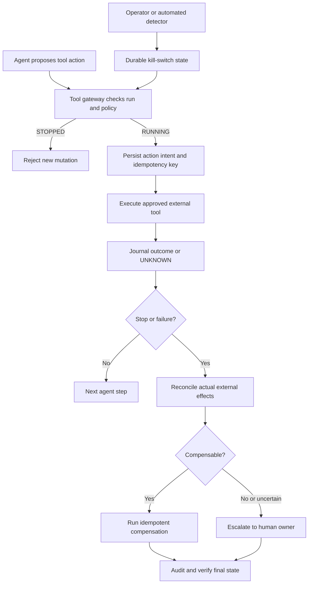

# Agent Kill Switches and Compensating Actions: Stop New Work, Repair Completed Work

> **Daily AI Engineering Learning | 14 October 2026 | Agents | Estimated reading time: 9 minutes**

**Central lesson:** A stop button and an undo button solve different problems. A **kill switch** blocks *future* agent actions; **compensation** addresses *past* actions that already changed a system. Enterprise agents need both, and neither should depend on the language model deciding to cooperate.

## Why this matters

Yesterday's shadow-run architecture protected production from candidate agents. Once an agent is allowed to operate on real repositories, API gateways, databases, or deployment systems, failures become operational incidents rather than poor chat answers. A migration agent might create a pull request, change a routing configuration, and then receive a malicious tool response telling it to publish a deployment. Stopping the LLM does not reverse the pull request or route change.

The recovery design belongs in the **harness and tool-execution layer**, not in a prompt. It should work when the model hangs, a worker crashes, or an operator presses STOP.

## Mental model: emergency brake plus repair crew

Think of a factory conveyor belt. Pulling the emergency brake prevents additional items from entering the machinery; it does not repair products already damaged. The repair crew needs a record of what happened and instructions for correcting it.

- **Kill switch:** a control-plane flag that forbids new actions for a run, tenant, tool, or agent version.
- **Side effect:** an external change, such as a Git commit, API route update, email, or Kafka event.
- **Compensating action:** a new business operation that counteracts an earlier side effect; it is not necessarily a database rollback.
- **Effect journal:** a persistent log of planned, attempted, confirmed, and compensated external actions.
- **Idempotency key:** a stable identifier that lets a tool safely recognize a repeated request rather than applying it twice.
- **Reconciliation:** checking the real external system when the journal cannot tell whether an action succeeded.
- **Irreversible action:** an action whose consequences cannot be fully undone, such as sending an email or exposing confidential data.

**Key distinction:** Canceling an agent's execution does not guarantee an in-flight HTTP request or queued background job has been canceled. Enforce the stop at the tool boundary, revoke write permissions when necessary, and reconcile ambiguous outcomes.

## Core components and request flow



1. **Identify the run:** assign a unique run ID, tenant ID, agent version, and correlation ID.
2. **Check before mutation:** the gateway reads the current stop policy; the LLM never directly holds unrestricted write credentials.
3. **Journal the intent:** persist action type, target, idempotency key, and intended compensation before making the external call.
4. **Execute with limits:** enforce allowlisted tools, scoped identity, timeouts, and concurrency limits. A short-lived authorization lease or fencing token reduces stale-worker races.
5. **Record or reconcile:** if the worker crashes after a tool succeeds but before the journal is updated, query the external system using the idempotency key or resource ID.
6. **On STOP:** reject future writes, cancel queued tasks where possible, and transition the run to a recovery state. Do not assume already-issued calls vanished.
7. **Compensate safely:** apply domain-specific corrections in dependency-aware order, verify outcomes, and escalate unresolved or irreversible effects.

A **fencing token** is a monotonically increasing authorization version. A gateway can reject a stale worker's action when its token no longer matches the current run authorization. This is stronger than checking a boolean only once.

## Concrete example: MuleSoft-to-Spring Boot migration

An agent has permission to migrate an integration endpoint in three stages:

- **Step A:** create a draft pull request containing generated Spring Boot code. Compensation: close the agent-created draft PR (preserve the audit trail).
- **Step B:** stage an API gateway route in a non-production environment. Compensation: restore the previous version *only if the route has not been changed by another actor*.
- **Step C:** publish a production cutover event. This is effectively irreversible for consumers that have already acted on it, so require an explicit human approval and a separate release gate.

Suppose the agent completes A and B, then the policy engine detects a prohibited production cutover attempt. The kill switch prevents C. Recovery reconciles the route and PR state, restores the route if safe, closes the draft PR if appropriate, and records evidence. It must not overwrite a teammate's later route update.

## Python: a small kill-and-compensate simulation

This example is deliberately local: `sqlite3` models the control/journal, and a Python set models an idempotent external service. It demonstrates ordering and recovery, **not** production-grade concurrency or cross-system atomicity.

```python
import sqlite3
from uuid import uuid4

db = sqlite3.connect(":memory:")
db.execute("CREATE TABLE runs (id TEXT PRIMARY KEY, state TEXT)")
db.execute("""CREATE TABLE journal (
    seq INTEGER PRIMARY KEY AUTOINCREMENT,
    run_id TEXT, effect TEXT, state TEXT,
    UNIQUE(run_id, effect)
)""")
effects = set()  # Fake external system, keyed by (run_id, effect)

def set_state(run_id, state):
    db.execute(
        "INSERT INTO runs VALUES (?, ?) "
        "ON CONFLICT(id) DO UPDATE SET state=excluded.state",
        (run_id, state),
    )
    db.commit()

def assert_running(run_id):
    row = db.execute("SELECT state FROM runs WHERE id=?", (run_id,)).fetchone()
    if not row or row[0] != "RUNNING":
        raise RuntimeError("Agent run stopped: tool mutation denied")

def apply(run_id, effect):
    assert_running(run_id)
    db.execute(
        "INSERT OR IGNORE INTO journal(run_id,effect,state) "
        "VALUES (?, ?, 'INTENT')", (run_id, effect)
    )
    db.commit()  # Persist intent before external side effect
    assert_running(run_id)
    effects.add((run_id, effect))  # Idempotent mock external call
    db.execute(
        "UPDATE journal SET state='APPLIED' "
        "WHERE run_id=? AND effect=?", (run_id, effect)
    )
    db.commit()

def compensate(run_id):
    rows = db.execute(
        "SELECT effect FROM journal WHERE run_id=? ORDER BY seq DESC",
        (run_id,),
    ).fetchall()
    for (effect,) in rows:
        # Real implementation: query external system, then compensate safely.
        effects.discard((run_id, effect))
        db.execute(
            "UPDATE journal SET state='COMPENSATED' "
            "WHERE run_id=? AND effect=?", (run_id, effect)
        )
        db.commit()

run = uuid4().hex
set_state(run, "RUNNING")
apply(run, "create-draft-pr")
apply(run, "stage-api-route")
set_state(run, "STOPPED")  # Operator presses kill switch

try:
    apply(run, "publish-cutover-event")
except RuntimeError as exc:
    print(exc)

compensate(run)
print("Remaining effects:", effects)
print("Journal:", db.execute(
    "SELECT effect,state FROM journal WHERE run_id=? ORDER BY seq",
    (run,)
).fetchall())
```

Expected result: the cutover is rejected, the simulated effects are empty, and both earlier journal entries are marked `COMPENSATED`.

**Important limitations:** The local set disappears on process restart; a real tool must expose resource IDs and reconciliation APIs. There is a race between the final stop check and the external call; solve it with authorization enforced at the gateway or downstream service, using leases/fencing and revocable credentials. A compensation can fail, so retain the journal and retry safely rather than marking success optimistically. Never compensate an effect solely because an `INTENT` row exists: first determine whether the effect actually occurred.

## Common mistakes and failure modes

- **Prompt-only stop:** “Please stop” is not a security control. Enforce deny decisions outside the model.
- **Confusing stop with rollback:** stopping orchestration does not undo successful HTTP calls or events.
- **No journal before writes:** a crash leaves an unknown external state. Record intent first and reconcile later.
- **Blind inverse operation:** restoring a stale API configuration can erase another team's changes. Use conditional updates or human review.
- **Non-idempotent recovery:** repeated compensation sends duplicate cancellations or refunds. Use stable keys and check outcomes.
- **Assuming all actions are reversible:** emails, leaked secrets, and consumer-observed events require incident response, not a fictitious undo.
- **Only run-level controls:** add tenant-wide, tool-wide, and agent-version kill switches for systemic incidents.
- **Treating STOPPED as recovered:** distinguish `STOPPED`, `RECOVERING`, `RECOVERED`, and `NEEDS_REVIEW`.

## Enterprise use cases

**Code migration:** close agent-owned draft PRs, revert isolated generated commits, and disable staging deployments; require approval for merge or production cutover.

**API management:** prevent new route/policy writes, restore a versioned configuration conditionally, and validate effective gateway state.

**Insurance operations:** stop claims-agent payment actions; where a payment was already initiated, follow the payment provider's reversal/adjustment workflow with human oversight.

**Data engineering:** suspend ingestion jobs, quarantine outputs, and apply compensating records instead of deleting shared production history.

## Practical architecture guidance

Start with a small, independent **control-plane service** that owns run status and policy version. Route all mutating tools through a **tool gateway** that validates scoped identity, stop state, approval, and idempotency. Store an append-only effect journal in a durable database. Keep a recovery worker separate from the agent so it can operate when the agent process is unhealthy.

Treat each action as one of **read-only**, **reversible**, **conditionally reversible**, or **irreversible**. Define the compensation contract, preconditions, verification query, owner, and maximum retry policy before granting the agent write access. Use human approval for irreversible steps. Emit structured events for `kill_switch_activated`, `mutation_denied`, `effect_unknown`, `compensation_attempted`, and `recovery_verified`; alert when a run remains in `NEEDS_REVIEW`.

**Java:** Spring Boot can enforce this in a tool-execution interceptor; use PostgreSQL transactions for the journal, optimistic locking for route revisions, and Resilience4j for bounded retries/circuit breakers. **Go:** put policy enforcement in a gateway middleware; propagate `context.Context` cancellation, but still require downstream idempotency and reconciliation because context cancellation cannot reverse completed side effects.

**Cloud mapping, when useful:** AWS Step Functions Standard workflows provide execution control and `Retry`/`Catch`; `StopExecution` does not by itself compensate external writes. Azure Durable Functions or Container Apps with Service Bus and Cosmos DB can orchestrate a compensating workflow. On GCP, Workflows plus Cloud Run and Firestore/Cloud SQL can implement the same journal-and-recovery design. In all clouds, external write permissions and compensation semantics remain your responsibility.

## Hands-on design task (45–60 minutes)

Take a migration agent with three tools: `create_pr`, `stage_gateway_route`, and `publish_cutover_event`. Draw its state machine with `RUNNING`, `STOPPED`, `RECOVERING`, `RECOVERED`, and `NEEDS_REVIEW`. Extend the Python sample to inject a crash **after** the fake route write but **before** journal confirmation; implement reconciliation to discover the actual effect. Add one test proving that a stale worker cannot publish after STOP, and one test proving that a changed route revision triggers human review rather than a blind restore.

**Definition of done:** no new side effects after the gateway observes STOP; every attempted side effect is accounted for as absent, compensated, retained by policy, or awaiting review. Do not claim the system provides instantaneous cancellation of in-flight operations.

## What to learn next

**Cancellation propagation and fencing:** how leases, scoped credentials, and gateway-side authorization prevent stale or disconnected workers from performing late writes.

## Further reading

1. [Microsoft Azure Architecture Center — Compensating Transaction pattern](https://learn.microsoft.com/en-us/azure/architecture/patterns/compensating-transaction) — best primary explanation of domain-aware recovery, concurrency, and idempotency.
2. [AWS Step Functions — StopExecution API](https://docs.aws.amazon.com/step-functions/latest/apireference/API_StopExecution.html) — the boundary of orchestration cancellation.
3. [AWS Step Functions — Error handling, Retry and Catch](https://docs.aws.amazon.com/step-functions/latest/dg/concepts-error-handling.html) — bounded retries and error transitions.
4. [LangGraph — Human-in-the-loop interrupt reference](https://reference.langchain.com/python/langgraph/types/interrupt) — pausing an agent for approvals; do not place irreversible side effects before a resumable interrupt.
