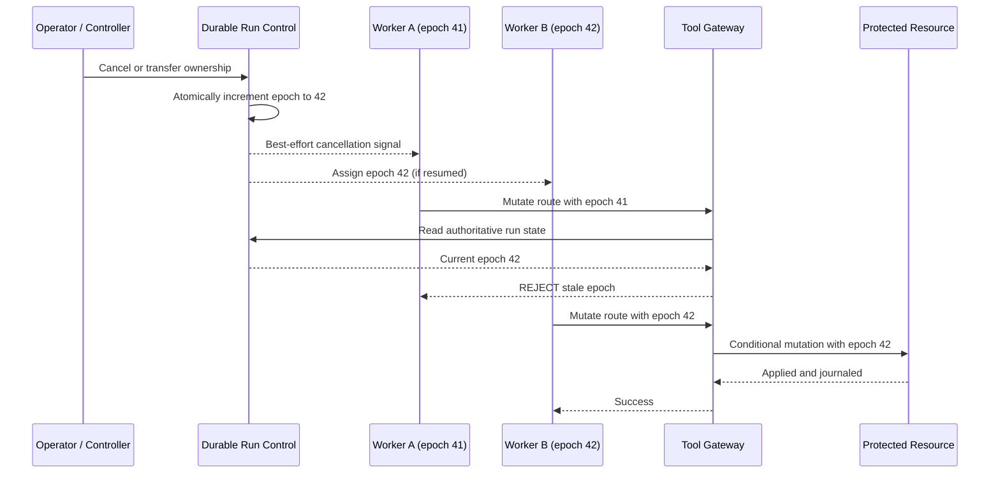

# Cancellation Propagation and Fencing Tokens: Stop Stale Agent Workers

> **Daily AI Engineering Learning | 15 October 2026 | Agents | Estimated reading time: 9 minutes**
**Central lesson:** Cancellation is a *request to stop*; fencing is a *rule that prevents obsolete workers from writing*. An enterprise agent needs both. A canceled Python coroutine, timed-out workflow, or terminated orchestrator may still leave an external HTTP call, queue consumer, or subprocess running.
## Why this matters
Yesterday we covered kill switches and compensating actions. Today's question is subtler: **what happens when a worker was authorized five seconds ago, but its authorization is now revoked?** Consider a migration agent generating Spring Boot services, running tests, and updating an API gateway. Worker A pauses during a network call. An operator stops the run, or worker B takes over after a lease expires. When A resumes, it must not publish a stale configuration.
Without a boundary check, a stop button can give a false sense of safety. Microsoft documents that terminating a Durable Functions orchestration does not currently terminate its activity functions or sub-orchestrations. Temporal likewise distinguishes cooperative cancellation from forceful termination. These are workflow-level semantics, not a guarantee that a downstream side effect was prevented.
## Mental model: a canceled meeting invitation versus a revoked access badge
Imagine an office meeting. Sending a cancellation email asks attendees not to come, but somebody offline might still arrive. Revoking their badge at the door ensures they cannot enter even if they missed the message.
- **Cancellation propagation:** forwarding a stop signal from a parent run to child tasks, workers, and tool calls. Usually cooperative: the recipient must check and respond.
- **Lease:** time-limited permission to work. It helps detect abandoned workers, but expiry alone cannot stop a paused worker from resuming.
- **Fencing token:** a monotonically increasing authorization generation (for example, 41 then 42). A stale worker with 41 must be rejected once 42 is current.
- **Stale worker:** an old worker that continues after a stop, timeout, retry, or ownership transfer.
- **Tool gateway:** the service that authenticates, authorizes, logs, and dispatches agent tool operations.
- **Linearizable update:** a coordination operation that behaves as if it happened atomically at one instant, allowing all workers to agree on the current generation.
- **Idempotency key:** a stable identifier used to recognize retries of the same external operation and avoid duplicate effects.
**Rule:** A token has no protective value unless the system that performs the mutation checks it. If a downstream system cannot check generations, use a controlled gateway that serializes authorization and mutation, or conditional writes at the target; otherwise acknowledge a remaining race.
## Core components and request flow

1. **Create the run:** persist run ID, tenant, status RUNNING, and initial generation. Issue short-lived, narrowly scoped tool credentials.
2. **Dispatch child work:** include run ID, generation, operation ID, deadline, and idempotency key in each task envelope. Do not put unrestricted credentials in model context.
3. **Propagate stop:** on cancellation, mark the run STOPPED and increment its generation in one durable transaction. Signal queued jobs, subprocesses, and child workflows; do not depend on their cooperation for safety.
4. **Fence writes:** before a side-effecting tool operation, verify that status is RUNNING and its generation matches the authoritative value. Make the verification atomic with the protected mutation wherever possible.
5. **Reconcile uncertain outcomes:** a request that passed authorization before cancellation may already have reached the external service. Inspect actual state and the effect journal; do not automatically retry with a new generation.
6. **Resume deliberately:** a new worker receives a *new* generation. Never reuse a previous token after restart or failover.
**Subtlety:** Some systems implement fencing by remembering the highest generation already *seen by the resource* and rejecting smaller generations. This is sufficient to reject an old write after a newer one reaches that resource, but may not reject an old write in the gap before the new worker's first write. A gateway that checks the current authoritative run generation can close that gap only if the check and mutation are coordinated; a separate read followed by an unrestricted external write still has a time-of-check/time-of-use race.
## Concrete enterprise example: MuleSoft to Spring Boot migration
The agent discovers a MuleSoft flow, generates a Spring Boot service, runs parity tests, and proposes a non-production API route update.
At 10:00:00, worker A starts an API-route update with generation 41. At 10:00:03, A stalls while preparing the request. At 10:00:05, the orchestrator transfers ownership to worker B and issues generation 42. At 10:00:07, A resumes and attempts the route update.
A naive design checks only whether A once held a valid lease. It might overwrite B's later route configuration. A fenced design rejects A's generation 41 at the tool gateway or target resource. B can proceed with 42 only while the run remains RUNNING. If the operator instead cancels the run, **neither** generation is authorized to mutate.
The LLM can plan or explain the operation, but the authorization decision belongs to deterministic infrastructure. A model instruction such as “stop when asked” is not an access-control mechanism.
## Python: runnable local simulation
This small example uses a single SQLite database to make run-state verification and a simulated resource write one atomic transaction. It demonstrates the invariant; it does **not** model a remote API, distributed consensus, or a real multi-process gateway.
```python
import sqlite3

db = sqlite3.connect(":memory:", isolation_level=None)
db.execute("CREATE TABLE run (id TEXT PRIMARY KEY, epoch INTEGER, status TEXT)")
db.execute("CREATE TABLE route (id TEXT PRIMARY KEY, config TEXT)")
db.execute("INSERT INTO run VALUES ('migration-7', 41, 'RUNNING')")
db.execute("INSERT INTO route VALUES ('customer-api', 'v1')")

def advance_epoch(stop=False):
    db.execute("BEGIN IMMEDIATE")
    try:
        db.execute(
            "UPDATE run SET epoch = epoch + 1, status = ? WHERE id = ?",
            ("STOPPED" if stop else "RUNNING", "migration-7"),
        )
        epoch = db.execute(
            "SELECT epoch FROM run WHERE id = ?", ("migration-7",)
        ).fetchone()[0]
        db.execute("COMMIT")
        return epoch
    except Exception:
        db.execute("ROLLBACK")
        raise

def update_route(worker_epoch, new_config):
    db.execute("BEGIN IMMEDIATE")
    try:
        current_epoch, status = db.execute(
            "SELECT epoch, status FROM run WHERE id = ?", ("migration-7",)
        ).fetchone()
        if status != "RUNNING" or worker_epoch != current_epoch:
            raise PermissionError(
                f"fenced: worker={worker_epoch}, current={current_epoch}, "
                f"status={status}"
            )
        db.execute(
            "UPDATE route SET config = ? WHERE id = ?",
            (new_config, "customer-api"),
        )
        db.execute("COMMIT")
    except Exception:
        db.execute("ROLLBACK")
        raise

old_worker = 41
new_worker = advance_epoch()       # takeover: generation 42

try:
    update_route(old_worker, "stale-v2")
except PermissionError as exc:
    print(exc)                    # stale worker is rejected

update_route(new_worker, "approved-v2")
advance_epoch(stop=True)          # STOPPED, generation 43

try:
    update_route(new_worker, "unsafe-v3")
except PermissionError as exc:
    print(exc)                    # even worker 42 is now rejected

print(db.execute("SELECT config FROM route").fetchone()[0])
# approved-v2
```
The important property is **atomic check + write**. The example uses SQLite's `BEGIN IMMEDIATE` transaction so a stop/takeover and route mutation cannot interleave within this database. For a real API gateway or Git repository, this guarantee does not magically extend across the network. Implement a target-side conditional version check, a transactionally serialized tool adapter, or an equivalent resource-specific fencing mechanism.
## Production implementation guidance
**Control plane:** store status and generation in a durable, strongly consistent database or coordination service. Scope generations to the protected run/resource. Advance them on cancellation, ownership transfer, or explicit restart. Preserve an audit record of who initiated the change.
**Execution plane:** propagate deadlines and cancellation through Python `asyncio.TaskGroup` and `asyncio.CancelledError`; don't swallow cancellation exceptions. Use request timeouts, heartbeat/checkpoint mechanisms for long jobs, and explicit subprocess termination when appropriate. None of these substitutes for a fenced write boundary.
**Tool plane:** require run ID, epoch, action ID, principal, target, and idempotency key on mutations. Enforce allowlists and approval policies before issuing credentials. For a resource with conditional updates, check the current generation or version atomically at the target. For systems lacking that feature, narrow write access behind one serialized adapter and document residual races and reconciliation procedures.
**Observability:** trace cancellation_requested, epoch_advanced, stale_write_rejected, mutation_committed, and uncertain_external_outcome. Measure time from stop request to last authorized write and the count of rejected stale operations. Never log raw secrets or sensitive payloads.
**Java / Go:** in Java, propagate interruption and structured cancellation through executors or virtual threads, but use an epoch check for writes. In Go, pass `context.Context` through call chains and check `ctx.Err()`; canceled contexts signal abandonment, not rollback. Both still need server-side authorization fencing.
**Cloud mapping (only where it helps):** AWS Step Functions `StopExecution` controls Standard workflow execution, not a universal remote-side-effect kill switch; pair it with application authorization. Azure Durable Functions documents that orchestration termination does not propagate to already-running activities. On GCP, use Cloud Run/Workflows for orchestration and a transactional authorization store (for example, Cloud SQL) or target-side preconditions for the write boundary. These are architectural mappings, not claims of built-in end-to-end fencing.
## Common mistakes and failure modes
- **Canceling only the LLM call:** a queue consumer or already-issued tool request can continue.
- **Checking status once at task start:** status can change before the mutation; re-check at the boundary.
- **Assuming lease expiry kills the old holder:** a paused worker can wake up after a new lease is granted.
- **Generating epochs from local clocks or random UUIDs:** uniqueness is not monotonic ordering; use an authoritative generator.
- **Fencing only at the caller:** a read-then-write across services leaves a race unless the resource enforces a condition.
- **Blind retries after timeouts:** the first request may have succeeded; reconcile by operation ID before retrying.
- **Reusing a token on resume:** a new owner must get a higher generation.
- **Treating STOPPED as undone:** completed side effects still need an effect journal and compensation policy.
## Enterprise use cases
- **Migration automation:** prevent obsolete workers from updating generated-code branches, deployment manifests, or API routes.
- **Coding assistants:** revoke write access to repositories after a user cancels a refactor, while preserving read-only diagnostics.
- **Agentic RAG:** stop a stale ingestion/index-update worker from publishing an older knowledge-base snapshot.
- **Operations agents:** fence infrastructure mutations after incident-response ownership changes.
- **Claims or customer-service agents:** ensure canceled workflows cannot send delayed external updates without reauthorization.
## 45–60 minute hands-on exercise
**Build a stale-worker test harness.** Start with the SQLite script above. First, add a `run_id` parameter and support two independent runs. Next, create a test that issues generation 7 to worker A, transfers ownership to worker B (generation 8), and proves A cannot write. Then cancel the run and prove B cannot write either. Finally, simulate an ambiguous external outcome: record an operation as `UNKNOWN` and design a read-only reconciliation query before any retry.
**Acceptance criteria:** four assertions pass: current owner can write, stale owner cannot write, stopped run cannot write, and unknown outcomes are not blindly retried. Stretch goal: add an audit table with timestamps and idempotency keys. You should be able to complete the core in under an hour.
## What to learn next
**Idempotency and reconciliation at the tool boundary:** how to handle the hardest failure window—an external tool succeeds, but the agent times out before recording the result.
## Further reading
1. [Martin Kleppmann — How to do distributed locking (fencing tokens)](https://martin.kleppmann.com/2016/02/08/how-to-do-distributed-locking.html) — the primary explanation of stale lock holders and resource-side fencing.
2. [Temporal — Cancellation and termination](https://github.com/temporalio/documentation/blob/main/docs/encyclopedia/workflow/cancellation-and-termination.mdx) — cooperative cancellation, termination, and activity heartbeat implications.
3. [Microsoft Learn — Manage Durable Functions orchestration instances](https://learn.microsoft.com/en-gb/azure/azure-functions/durable/durable-functions-instance-management) — the documented limit of termination propagation.
4. [AWS — Step Functions StopExecution API](https://docs.aws.amazon.com/step-functions/latest/apireference/API_StopExecution.html) — workflow stop semantics and Standard-versus-Express scope.
5. [Go standard library — context](https://pkg.go.dev/context) — cancellation signals, deadlines, and propagation across call chains.
