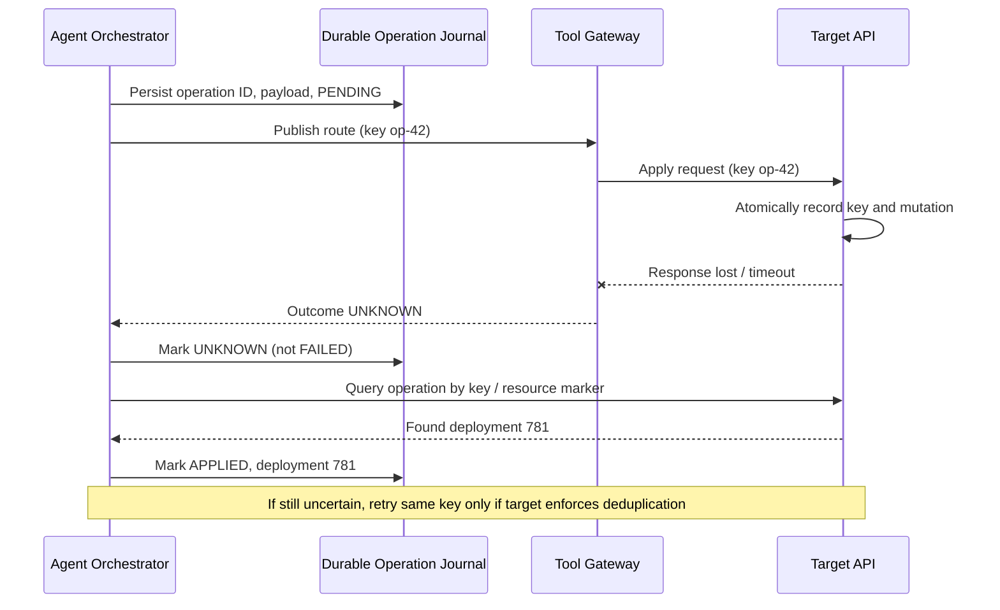

# Idempotency and Reconciliation at the Agent Tool Boundary

> **Daily AI Engineering Learning | 16 October 2026 | Agents | Estimated reading time: 9 minutes**
>
> **Central lesson:** A timeout tells you that a response was not received—not that the operation failed. When an agent invokes a tool that changes external state, give that *logical operation* a durable identity and reconcile the result before repeating it.

## Why this matters

Yesterday's lesson used cancellation and fencing tokens to stop stale workers. Today's problem happens even with a correctly authorized worker: the tool may finish its work, but its response gets lost. An agent migrating a MuleSoft flow to Spring Boot publishes a test API route. The API gateway commits the route, yet the agent times out. The agent sees an error and publishes again, accidentally creating a second deployment record or repeating a notification.

The reliable design is **at-least-once invocation with at-most-once business effects for each logical operation**, where the target can enforce that contract. It is not a magical distributed “exactly once” guarantee.

## Mental model: a parcel with a tracking number

If you order a parcel and the confirmation page freezes, you should check the order number before placing a second order. The order number represents your *intent*, not a single network attempt.

- **Logical operation:** one intended business change, such as “publish migration-42's route revision 3.”
- **Idempotency:** repeating that operation does not create additional business effects.
- **Idempotency key:** stable identifier attached to every retry of the *same* logical operation.
- **Operation journal:** durable record of intended actions, request parameters, attempts, and outcomes.
- **Reconciliation:** checking authoritative external state to determine whether an uncertain action actually happened.
- **Ambiguous outcome:** an exception or timeout that cannot prove success or failure.
- **Payload fingerprint:** digest of the canonical request parameters; it detects accidental reuse of a key for a different action.

An idempotency key is not simply a hash of the payload: two deliberately separate deployments might have identical parameters. The agent's orchestrator should assign a unique operation ID when it decides to perform an action and reuse that ID only for retries of that action.

## Components and request flow



1. **Plan:** an LLM proposes a tool call, but the deterministic orchestrator validates its parameters, permissions, and target.
2. **Record intent:** persist a unique operation ID, tenant, target, canonical payload fingerprint, run ID, and status `PENDING` *before* dispatch. Keep the key stable across process restarts.
3. **Execute:** the tool gateway sends the key to an API that implements deduplication. The target must atomically associate the key with the resulting mutation, or provide an equivalent transactionally safe contract.
4. **Classify:** a confirmed response becomes `APPLIED`; a known validation rejection becomes `REJECTED`; timeout or connection reset becomes `UNKNOWN`.
5. **Reconcile:** look up the operation by key, query a resource carrying that key, or inspect an authoritative event/audit log. Match tenant, operation ID, and payload fingerprint.
6. **Recover:** if the target confirms the effect, record its resource ID. If it confirms non-execution, retry as permitted. If the outcome remains uncertain and the target lacks idempotency, stop automatic retries and escalate.

**Key distinction:** Fencing answers “is this worker still allowed to act?” Idempotency answers “has this particular intended action already happened?” Both controls are needed.

## Concrete example: migration-agent API route publication

A migration agent converts a MuleSoft HTTP listener into a Spring Boot endpoint. Parity tests pass. The workflow now asks a staging API management service to publish route `customer-v2` for migration `mig-42`.

The orchestrator assigns `mig-42:publish-route:revision-3`. On the first attempt, the target creates deployment 781, but the HTTP response is lost. The journal records `UNKNOWN`. On recovery, the gateway queries by the operation ID and discovers deployment 781. It records `APPLIED` rather than submitting a new deployment.

If the agent later publishes revision 4, that is **new intent** and needs a new key. Reusing the revision-3 key with a different configuration must be rejected, not silently accepted.

## Python: runnable simulation of the uncertain-outcome case

The following uses only the Python standard library. SQLite stands in for a *single target service* that can commit the idempotency record and deployment together. A Python dictionary represents the caller's journal for demonstration only; use a durable database in production.

```python
import hashlib
import json
import sqlite3

db = sqlite3.connect(":memory:", isolation_level=None)
db.execute("""CREATE TABLE operations (
    tenant TEXT NOT NULL, op_key TEXT NOT NULL,
    fingerprint TEXT NOT NULL, deployment_id INTEGER NOT NULL,
    PRIMARY KEY (tenant, op_key)
)""")
db.execute("""CREATE TABLE deployments (
    id INTEGER PRIMARY KEY AUTOINCREMENT,
    tenant TEXT NOT NULL, route TEXT NOT NULL, config TEXT NOT NULL
)""")

def fingerprint(route, config):
    payload = json.dumps({"route": route, "config": config},
                         sort_keys=True, separators=(",", ":"))
    return hashlib.sha256(payload.encode()).hexdigest()

def publish(tenant, key, route, config, lose_response=False):
    fp = fingerprint(route, config)
    db.execute("BEGIN IMMEDIATE")
    try:
        row = db.execute(
            "SELECT fingerprint, deployment_id FROM operations "
            "WHERE tenant=? AND op_key=?", (tenant, key)
        ).fetchone()
        if row:
            if row[0] != fp:
                raise ValueError("Same key used with different parameters")
            deployment_id = row[1]
        else:
            cursor = db.execute(
                "INSERT INTO deployments(tenant, route, config) VALUES(?,?,?)",
                (tenant, route, config)
            )
            deployment_id = cursor.lastrowid
            db.execute(
                "INSERT INTO operations VALUES(?,?,?,?)",
                (tenant, key, fp, deployment_id)
            )
        db.execute("COMMIT")
    except Exception:
        db.execute("ROLLBACK")
        raise
    if lose_response:  # simulate a response lost AFTER target commit
        raise TimeoutError("Reply lost after commit")
    return deployment_id

def lookup(tenant, key):
    row = db.execute(
        "SELECT deployment_id FROM operations WHERE tenant=? AND op_key=?",
        (tenant, key)
    ).fetchone()
    return row[0] if row else None

tenant, key = "team-a", "mig-42:publish-route:revision-3"
journal = {key: "PENDING"}  # illustrative; persist before send in production
try:
    publish(tenant, key, "customer-v2", "springboot:v3",
            lose_response=True)
except TimeoutError:
    journal[key] = "UNKNOWN"

deployment = lookup(tenant, key)  # authoritative reconciliation
if deployment is not None:
    journal[key] = "APPLIED"
else:
    # Safe ONLY because this target implements durable idempotency.
    deployment = publish(tenant, key, "customer-v2", "springboot:v3")
    journal[key] = "APPLIED"

assert publish(tenant, key, "customer-v2", "springboot:v3") == deployment
assert db.execute("SELECT COUNT(*) FROM deployments").fetchone()[0] == 1
try:
    publish(tenant, key, "customer-v2", "springboot:v4")
except ValueError:
    print("Parameter mismatch rejected")
print(journal, "deployment:", deployment)  # APPLIED; one deployment
```

**What this proves:** The target's unique constraint and transaction prevent duplicate deployments for a key, even when a response disappears. **What it does not prove:** An agent can achieve the same guarantee across two independent databases or arbitrary external APIs. If the target cannot atomically record the key and the effect, a crash between those actions can still produce duplicates.

## Implementation guidance for enterprise systems

**Operation identity:** derive or allocate a unique ID at the orchestration layer when the logical action is first scheduled. Persist it with the request payload and reuse it across retries and worker takeovers. Scope uniqueness by tenant and operation type. Do not place customer PII or secrets in keys.

**Target-side enforcement:** prefer APIs that accept an `Idempotency-Key` or equivalent client token. For services you own, use a unique constraint plus a transaction that writes both the effect and the idempotency record. Store enough response data to return a semantically equivalent result. Reject a reused key with a changed fingerprint.

**Unknown is a real state:** never translate a network timeout into `FAILED` without evidence. Use `PENDING → APPLIED / REJECTED / UNKNOWN` and a reconciler that periodically revisits `UNKNOWN`. Keep an audit trail of attempts and evidence used to resolve them.

**Bounded retries:** retry transient failures with backoff, jitter, and a deadline. Respect the provider's key-retention window; a very late retry after deduplication expires may create a new effect. For a persistent `UNKNOWN` result, require human review rather than manufacturing certainty.

**Concurrency and authorization:** serialize conflicting updates or use conditional target-side versions. Apply the fencing and permission checks from earlier lessons independently. A valid idempotency key does not authorize an operation or protect against an outdated worker.

**Observability:** emit `run_id`, `operation_id`, `tool_name`, `attempt`, `outcome`, `reconciliation_method`, and `external_resource_id`. Track unknown-outcome age, duplicate-suppression counts, reconciliation success, and unresolved operations. Redact payloads and credentials.

**Python:** use a transactional journal in PostgreSQL/SQLite and an HTTP client with explicit timeout and retry policy. **Java:** a Spring Boot tool adapter can use a database unique constraint and `@Transactional` for same-database effects. **Go:** pass `context.Context` deadlines and persist operation IDs before outbound calls; cancellation alone does not roll back external effects.

**Cloud mapping, when useful:** On AWS, DynamoDB conditional writes can enforce unique operation IDs and Step Functions can coordinate recovery. On Azure, Azure SQL/Cosmos DB can hold the operation journal while Durable Functions coordinates retries. On GCP, Cloud SQL can enforce uniqueness and Pub/Sub can deliver work. **Important:** a messaging service's “exactly once” delivery feature does not guarantee exactly-once changes to external systems.

## Common mistakes and failure modes

- **New key on every retry:** defeats deduplication; persist the original key before dispatch.
- **Payload hash as the only key:** confuses identical but independent user intentions.
- **“Timeout means failure”:** triggers duplicate side effects; represent `UNKNOWN` explicitly.
- **Read-then-write deduplication:** races under concurrent requests; use an atomic constraint or target-side transaction.
- **Assuming a local journal protects a remote API:** it cannot prove what a remote service committed.
- **Reusing a key for changed parameters:** reject mismatches; allocate a new key for new intent.
- **Assuming all 5xx errors are safe to retry with a new key:** a server may have already committed work.
- **Assuming queue deduplication covers downstream writes:** external effects need their own idempotency boundary.

## Enterprise use cases

- **Migration automation:** publish generated services, routes, repositories, and deployment records without duplicate provisioning.
- **Insurance operations:** create claim tasks and case updates once per approved business action.
- **Coding assistants:** avoid duplicate pull requests or issue comments after timeouts.
- **Agentic RAG:** ensure write-back of annotations or knowledge-base changes is not repeated when retrieval or tool workflows restart.

## Hands-on exercise (45–60 minutes)

1. Run the Python example and confirm that one lost response plus two retries still creates exactly **one** deployment.
2. Add a second operation ID for revision 4; confirm that it creates a **second intentional** deployment.
3. Simulate an `UNKNOWN` outcome where `lookup()` is unavailable. Design a policy that pauses instead of blindly retrying against a target without deduplication.
4. Add a small persistent journal table and a `reconcile_unknown()` function. Record which evidence resolved each operation.

**Design check:** Can your architecture distinguish “we did not receive a response” from “the target did not perform the action”? If not, the retry policy is incomplete.

## What to learn next

**Transactional outbox and reconciliation workers:** reliably connect a committed local decision to an eventual external tool invocation without losing intent between database commit and message dispatch.

## Reading (primary sources)

1. [AWS Builders' Library — Making retries safe with idempotent APIs](https://aws.amazon.com/builders-library/making-retries-safe-with-idempotent-APIs/) — why caller-supplied intent IDs and atomic deduplication matter.
2. [Stripe — Idempotent requests](https://docs.stripe.com/api/idempotent_requests) — a concrete HTTP API contract and key-reuse behavior.
3. [Temporal — Activity definition and retries](https://docs.temporal.io/activity-definition) — why workflow activities need idempotent side effects.
4. [Google Cloud — Pub/Sub exactly-once delivery](https://docs.cloud.google.com/pubsub/docs/exactly-once-delivery) — the boundary between message delivery and external business effects.
